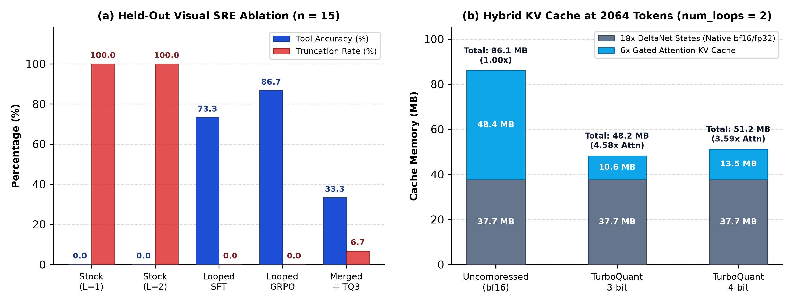

<div align="center">

# Looped Hybrid Qwen3.5 for Visual SRE Incident Triage

*Pushing a 0.8B multimodal hybrid model from 0.0% to 86.7% held-out Grafana triage accuracy on a single 8 GB RTX 4060 Laptop GPU.*

<p>
  
  
  
  
  
</p>

<p>
  <a href="docs/Looped_Hybrid_Qwen35_Visual_SRE_Paper.pdf">
    
  </a>
  <a href="docs/Visual_SRE_Looped_Qwen35_Dev_Diary.pdf">
    
  </a>
</p>

</div>

---

## Visual Showcase

<table>
  <tr>
    <td width="46%" align="center">
      
      <br />
      <sub><b>Input Telemetry:</b> Synthetic dark-mode 2x2 Grafana dashboard (<code>sre_042_incident.png</code>) encoding a cascading SEV1 multi-service SLO breach.</sub>
    </td>
    <td width="54%" align="center">
      
      <br />
      <sub><b>Results:</b> Held-out Visual SRE progression (0.0% to 73.3% to 86.7%) and 2064-token hybrid KV compression (4.58x Attention KV, untouched DeltaNet).</sub>
    </td>
  </tr>
</table>

---

## Key Results & Architecture Highlights

- **Non-Destructive Looped Hybrid Wrapper (`LoopedQwen3_5ForConditionalGeneration`):** Loops hidden states through Qwen3.5's 24 hybrid decoder layers (**18 Gated DeltaNet** recurrent layers + **6 Gated Attention** layers) `num_loops` times (effective depth 48 at `num_loops=2`) while remaining bit-exact with stock `Qwen/Qwen3.5-0.8B` at `num_loops=1` (`max_abs_diff = 0.000000`).
- **Scalar Input Re-Injection (`reinject_logit`):** Captures `base_inputs_embeds` after the native vision encoder merges image patches and blends `h = sigmoid(reinject_logit) * base_inputs_embeds + (1 - sigmoid(reinject_logit)) * h` before every loop `t >= 1` (initialized at `4.6`, `w ≈ 0.990`), keeping visual charts grounded across loops.
- **Per-Loop Hybrid Cache Isolation (`PerLoopHybridCache`):** Allocates independent `DynamicCache` instances per loop so Gated DeltaNet causal conv and recurrent states are never double- or triple-counted during cached autoregressive decoding.
- **Leakage-Proof Visual SRE Distillation & Looped SFT:** Harvested 34 validated DeepSeek CoT traces (including 8 multi-turn tool-error recovery traces) strictly on the 35 training prompts (SHA-256 verified `0` overlap with the 15 held-out prompts). Assistant-only masked PEFT LoRA (`r=16`, `alpha=32`, 10.82M trainable params = 1.25% across all 12 text-decoder linear projections) made held-out Loop 2 loss (`0.8897`) beat Loop 1 (`0.9562`), lifting tool accuracy from **0.0% to 73.3%** and cutting `<think>` truncation from **100.0% to 0.0%**.
- **Pure-PyTorch GRPO (RLVR) in 3.37 GB Peak VRAM:** Loads a frozen `ref` LoRA adapter (~21 MB overhead) on the same base weights for KL regularization (`beta=0.02`), micro-batches clipped surrogate updates one rollout at a time, and pushes held-out tool accuracy from **73.3% to 86.7% (13/15)** with mean reward `+0.8667`.
- **Weight-Space Programming (WSP) Rollback Guardrail:** Contrastively probed all 24 MLP `down_proj` layers on GRPO passing vs. failing traces (localizing layers 23 and 22, editing `0.0152%` of weights) and cleanly reverted because SFT + GRPO had already eliminated the infinite thinking-loop bug.
- **Hybrid-Safe TurboQuant KV Compression & Honest Trade-Off:** `TurboQuantHybridCache` applies Haar orthogonal rotation, `uint8` bit-packed Lloyd-Max centroids, and 1-bit QJL key residuals strictly to the **6 Gated Attention layers** while keeping all **18 DeltaNet states** untouched in native `bf16`/`fp32`. Achieves **4.58x** Attention KV compression at 3-bit (`48.38 MB -> 10.56 MB`) and **3.59x** at 4-bit on 2064 tokens, while exposing a real dense visual-patch OCR trade-off at 3-bit (`86.7% -> 33.3%` when ~1,100 chart patch tokens are flushed past the 64-token `bf16` window).
- **2B Scaling Readiness:** Verified identical 24-layer hybrid topology and 12/12 LoRA target matching (0 vision overlap) for `Qwen/Qwen3.5-2B` with `--model-size 2b` and optional `--load-in-4bit` QLoRA flags.

---

## Benchmark Tables

### 1. Held-Out Visual SRE Evaluation Ablation (`eval_heldout.jsonl`, 15 Unseen Prompts)

| Stage / Configuration | Loops | KV Quant | Tool Acc (%) | Schema Valid (%) | Format (%) | Mean Reward | Trunc Rate (%) | Loop Losses (L1 / L2 / L3) | Peak VRAM (GB) |
| :--- | :---: | :---: | :---: | :---: | :---: | :---: | :---: | :---: | :---: |
| Stock Qwen3.5-0.8B (1-Loop) | 1 | `none` | 0.0% | 0.0% | 0.0% | -0.2000 | 100.0% | 4.6063 / 4.6418 / 4.651 | 6.47 |
| Stock Qwen3.5-0.8B (2-Loop) | 2 | `none` | 0.0% | 0.0% | 0.0% | -0.2000 | 100.0% | 4.6063 / 4.6418 / 4.651 | 6.51 |
| Looped SFT (2-Loop LoRA) | 2 | `none` | 73.3% | 73.3% | 73.3% | 0.7333 | 0.0% | 4.494 / 4.4882 / 4.5084 | 6.55 |
| **Looped GRPO (2-Loop RLVR)** | **2** | **`none`** | **86.7%** | **86.7%** | **86.7%** | **0.8667** | **0.0%** | **4.4914 / 4.4869 / 4.4983** | **6.55** |
| Looped GRPO + WSP (Reverted) | 2 | `none` | 86.7% | 86.7% | 86.7% | 0.8667 | 0.0% | 4.4914 / 4.4869 / 4.4983 | 6.55 |
| Final Merged + TurboQuant 3-bit | 2 | `turboquant_3bit` | 33.3% | 40.0% | 66.7% | 0.3933 | 6.7% | 4.4928 / 4.4871 / 4.5013 | 6.47 |

### 2. Long-Context TurboQuant KV-Cache Benchmark (`2048 Prefill + 16 Decode`, `num_loops=2`, `residual_window=64`)

| KV Quant Mode | Cached Tokens | 6x Attention KV (MB) | 18x DeltaNet States (MB) | Total Cache (MB) | Attention KV Compression | Peak VRAM (GB) |
| :--- | :---: | :---: | :---: | :---: | :---: | :---: |
| `none` | 2064 | 48.38 MB | 37.69 MB | 86.06 MB | **1.00x** | 2.11 GB |
| `turboquant_3bit` | 2064 | 10.56 MB | 37.69 MB | 48.25 MB | **4.58x** | 2.07 GB |
| `turboquant_4bit` | 2064 | 13.49 MB | 37.69 MB | 51.18 MB | **3.59x** | 2.08 GB |

---

## Reproducible Quickstart

<details>
<summary><b>1. Dataset Generation, Stratified Splits & DeepSeek CoT Harvest</b></summary>

```bash
# Generate 50 balanced Visual SRE prompts (40 dark-mode 2x2 Grafana PNGs + 10 text alerts)
python cot_dataset_builder/generate_sre_dataset.py --count 50

# Create leakage-proof 35 train / 15 held-out stratified splits + SHA-256 manifest
python cot_dataset_builder/build_splits.py \
  --prompts cot_dataset_builder/niche_prompts.jsonl \
  --clean-dataset cot_dataset_builder/dataset_clean.jsonl \
  --eval-ratio 0.30

# Harvest DeepSeek CoT + 25% multi-turn error-recovery traces strictly on training prompts
cd cot_dataset_builder
python generate_dataset.py --input splits/train_grpo_prompts.jsonl --recovery-mode --recovery-ratio 0.25
```

</details>

<details>
<summary><b>2. Looped PEFT LoRA SFT (Phase 3)</b></summary>

```bash
python looped_qwen35/train_looped_sft.py \
  --dataset cot_dataset_builder/splits/train_sft.jsonl \
  --eval-dataset cot_dataset_builder/splits/eval_heldout.jsonl \
  --output-dir looped_qwen35/checkpoints/sft_sre \
  --num-loops 2 --epochs 3 --lr 2e-4 --grad-accum 4
```

</details>

<details>
<summary><b>3. Pure-PyTorch GRPO RLVR (Phase 4)</b></summary>

```bash
python looped_qwen35/train_looped_grpo.py \
  --sft-checkpoint looped_qwen35/checkpoints/sft_sre \
  --prompts cot_dataset_builder/splits/train_grpo_prompts.jsonl \
  --output-dir looped_qwen35/checkpoints/grpo_sre \
  --num-loops 2 --group-size 4 --steps 10 --save-every 5 --lr 1e-5 --kl-beta 0.02
```

</details>

<details>
<summary><b>4. Weight-Space Programming Audit (Phase 5)</b></summary>

```bash
python looped_qwen35/weight_editor.py \
  --checkpoint looped_qwen35/checkpoints/grpo_sre \
  --eval-report looped_qwen35/eval_results/grpo_sre.json \
  --eval-file cot_dataset_builder/splits/eval_heldout.jsonl \
  --run-name grpo_sre --num-loops 2 --top-layers 2 --top-columns 64 --alphas 0.10 0.25
```

</details>

<details>
<summary><b>5. Held-Out Evaluation Suite, Merge & Ablation Benchmark (Phases 2 & 7)</b></summary>

```bash
# Evaluate any checkpoint (stock, PEFT, or merged) on eval_heldout.jsonl
python looped_qwen35/eval_suite.py \
  --checkpoint looped_qwen35/checkpoints/grpo_sre \
  --run-name grpo_sre --num-loops 2 --kv-quant none

# Merge winning LoRA adapter + export self-contained model with loop_state.pt
python looped_qwen35/merge_and_export.py \
  --checkpoint looped_qwen35/checkpoints/grpo_sre \
  --output-dir looped_qwen35/exports/looped_qwen35_sre_final

# Aggregate ablation table + run 2048-token TurboQuant 3-bit/4-bit KV benchmark
python looped_qwen35/benchmark_ablation.py \
  --merged-model looped_qwen35/exports/looped_qwen35_sre_final
```

</details>

<details>
<summary><b>6. Inference with Hybrid-Safe TurboQuant KV Compression</b></summary>

```bash
# Uncompressed bf16 (recommended for dense visual Grafana OCR)
python looped_qwen35/infer_looped.py \
  --checkpoint looped_qwen35/checkpoints/grpo_sre \
  --image cot_dataset_builder/samples/sre_042_incident.png \
  --kv-quant none

# 3-bit or 4-bit TurboQuant (compresses 6 Gated Attention layers; 18 DeltaNet layers untouched)
python looped_qwen35/infer_looped.py \
  --checkpoint looped_qwen35/checkpoints/grpo_sre \
  --kv-quant turboquant_4bit --residual-window 64
```

</details>

---

<div align="center">
  <sub>Abhishek Satarkar | November 2026</sub>
</div>
